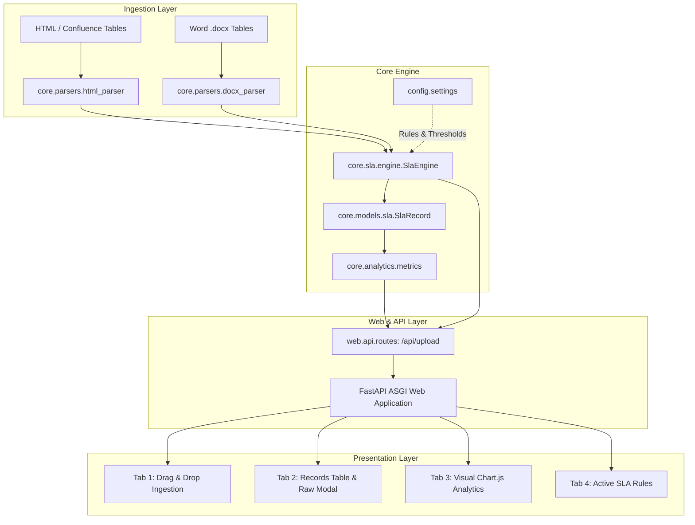

# SLA Breach Dashboard & Analyzer

> A modern, modular, production-ready Python web application to ingest Confluence HTML and Word (.docx) ticket tables, compute real-time SLA breaches and overdue metrics, and deliver interactive visual dashboards.

---

## Table of Contents

1. [Overview & Motivation](#overview--motivation)
2. [Architecture Overview](#architecture-overview)
3. [Quick Start (Single-Command Setup)](#quick-start-single-command-setup)
4. [Non-Technical Manager Runbook](#non-technical-manager-runbook)
   - [Workflow 1: Exporting Ticket Tables](#workflow-1-exporting-ticket-tables)
   - [Workflow 2: Drag-and-Drop Ingestion](#workflow-2-drag-and-drop-ingestion)
   - [Workflow 3: Interpreting Overview KPIs](#workflow-3-interpreting-overview-kpis)
   - [Workflow 4: Filtering and Inspecting Records](#workflow-4-filtering-and-inspecting-records)
   - [Workflow 5: Visual Analytics & Chart Deep-Dives](#workflow-5-visual-analytics--chart-deep-dives)
   - [Workflow 6: Customizing SLA Targets & Thresholds](#workflow-6-customizing-sla-targets--thresholds)
5. [REST API Documentation](#rest-api-documentation)
6. [Developer & Verification Guide](#developer--verification-guide)
7. [Configuration Reference](#configuration-reference)

---

## Overview & Motivation

In enterprise operations and incident management, ticket reports frequently export from Confluence pages and Word documentation trackers with inconsistent table layouts, missing columns, non-standard date formats, and variable priorities.

Legacy tools often rely on unmaintainable 1,600+ line monolithic scripts that fail on dirty markup, drop unmapped metadata, or crash without helpful diagnostics.

**The SLA Breach Dashboard & Analyzer** replaces monolithic scripts with a clean, decoupled Python architecture:
- **Resilient Parsing:** Handles malformed HTML, nested tables, multiple tables, merged DOCX cells, and dirty timestamps.
- **Dynamic SLA Calculation:** Resolves priorities (P1–P5, Blocker, Critical, Major, Minor, Trivial), tracks elapsed and overdue business duration, and categorizes severity (`OK`, `WARNING`, `BREACHED`, `CRITICAL`).
- **Interactive Multi-Tab Web Interface:** Built with FastAPI, Tailwind CSS, and Chart.js—zero heavyweight frontend frameworks required.
- **Single-Command Launch:** Instant local execution with automated browser launching via `python run.py`.

---

## Architecture Overview

The system follows a strict unidirectional data flow and clean separation of concerns:



### Directory Structure & Responsibilities

```
SLA-Breach/
├── config/
│   ├── default_sla_rules.yaml   # Canonical YAML rules, priority targets, column aliases
│   └── settings.py              # Pydantic BaseSettings & cached rules configuration
├── core/
│   ├── models/
│   │   └── sla.py               # Pydantic domain models (SlaRecord, SeverityLevel, ExtractionResult)
│   ├── parsers/
│   │   ├── date_parser.py       # Resilient datetime parsing with fallback chains
│   │   ├── docx_parser.py       # Word (.docx) table extractor with merged-cell support
│   │   └── html_parser.py       # BeautifulSoup4 Confluence/HTML table extractor
│   ├── sla/
│   │   ├── engine.py            # SLA calculation engine & overdue duration logic
│   │   └── severity.py          # Severity classifier (OK, WARNING, BREACHED, CRITICAL)
│   └── analytics/
│       └── metrics.py           # Overdue histograms, severity bins, team breach rankings
├── web/
│   ├── app.py                   # FastAPI ASGI factory, static mounting, CORS, error handlers
│   ├── api/
│   │   └── routes.py            # REST endpoints (/api/health, /api/rules, /api/upload)
│   ├── static/
│   │   ├── css/styles.css       # Custom styling, drag-and-drop animations, badge colors
│   │   └── js/app.js            # Frontend controller, Chart.js rendering, tab navigation
│   └── templates/
│       └── index.html           # Single-page multi-tab dashboard template
├── tests/                       # Complete pytest suite (Unit, Parser, API, UI, E2E)
├── run.py                       # Single-command server runner with CLI options
├── requirements.txt             # Locked Python production dependencies
└── pyproject.toml               # Project metadata and pytest configuration
```

---

## Quick Start (Single-Command Setup)

### Prerequisites
- Python 3.10 or newer (tested on Python 3.10–3.14)
- Pip package manager

### 1. Clone & Set Up Virtual Environment

**Windows (PowerShell):**
```powershell
git clone <repository-url>
cd SLA-Breach
python -m venv venv
.\venv\Scripts\Activate.ps1
pip install -r requirements.txt
```

**macOS / Linux (Bash):**
```bash
git clone <repository-url>
cd SLA-Breach
python3 -m venv venv
source venv/bin/activate
pip install -r requirements.txt
```

### 2. Launch the Application

Start the local server with one command:
```bash
python run.py --open-browser
```

The command automatically displays a startup banner and opens `http://127.0.0.1:8000` in your default browser:

```
======================================================================
  SLA Breach Dashboard & Analyzer (v1.0.0)
======================================================================
  * Dashboard URL:       http://127.0.0.1:8000
  * API Documentation:   http://127.0.0.1:8000/api/docs
  * Host / Port:         127.0.0.1:8000

  Status: Online and ready to accept file uploads (.html, .htm, .docx)
  Press CTRL+C to stop the server
======================================================================
```

### CLI Arguments for `run.py`

| Flag | Default | Description |
|------|---------|-------------|
| `--host HOST` | `127.0.0.1` | Network interface IP address to bind to |
| `--port PORT` | `8000` | Port number for the web server |
| `--open-browser` | `False` | Automatically launches system browser on startup |
| `--reload` | `False` | Enables auto-reload on code modifications |
| `--no-reload` | `False` | Explicitly disables auto-reload |
| `--log-level LEVEL`| `info` | Uvicorn logging verbosity (`critical`, `error`, `warning`, `info`, `debug`) |

---

## Non-Technical Manager Runbook

This step-by-step operational guide requires **zero coding knowledge** once the application is running.

### Workflow 1: Exporting Ticket Tables

1. **Confluence:**
   - Navigate to the page containing your incident, issue, or task table.
   - Click `...` (More actions) in the upper right header $\rightarrow$ Select **Export** $\rightarrow$ **Export to HTML** (or save the page as an `.html` file from your browser).
2. **Microsoft Word:**
   - If your team tracks incident summaries in Word, ensure the document has one or more standard tables.
   - Save the file as `.docx`.
3. **Supported Table Formats:**
   - The engine automatically detects header variations (e.g., `Issue key`, `Ticket ID`, `Key`, `Summary`, `Priority`, `Severity`, `Reported Date`, `Date Created`, `Assignee`, `Team`).

### Workflow 2: Drag-and-Drop Ingestion

1. Open `http://127.0.0.1:8000` in your web browser.
2. Under **Tab 1: Upload & Process**:
   - Drag and drop your `.html` or `.docx` file into the dashed drop area.
   - Alternatively, click the drop area to open your operating system file browser.
3. The upload progress spinner activates instantly.
4. When processing completes:
   - The **Summary Banner** displays the filename, total rows parsed, and unparsed rows (if any).
   - The **Executive KPI Cards** populate with real-time statistics.
   - You can click the quick-action button **"Go to Records"** or **"View Analytics"** to jump immediately to detailed views.

### Workflow 3: Interpreting Overview KPIs

At the top of the dashboard, five executive summary cards summarize the health of the uploaded batch:

| KPI Card | What It Means | Operational Action |
|----------|---------------|-------------------|
| **Total Records** | Total number of valid tickets extracted. | Verifies the entire export was recognized. |
| **Breached Count** | Number of tickets that exceeded their target SLA window. | Primary operational breach volume. |
| **Breach Rate (%)** | Percentage of tickets currently breached ($(\text{Breached} / \text{Total}) \times 100$). | High-level compliance SLA score. Target: < 5.0%. |
| **Avg Overdue Days**| Average days elapsed past SLA target for breached tickets. | Measures the severity of SLA slippage. |
| **Critical Volume** | Number of tickets overdue by more than 3.0 days. | **Immediate escalation** required for these tickets. |

### Workflow 4: Filtering and Inspecting Records

Switch to **Tab 2: Records Table** to explore individual tickets:

1. **Global Search:** Type any text into the search box to filter tickets in real-time by Key, Summary, Team, Status, or Priority.
2. **Priority Filter:** Drop down to isolate specific tiers (`P1`, `P2`, `P3`, `P4`, etc.).
3. **Severity Filter:** Filter by compliance status:
   - `OK (Compliant)`: Resolved within SLA or currently on track.
   - `WARNING`: Approaching deadline ($\ge 80\%$ of target window elapsed).
   - `BREACHED`: Overdue by $\le 3.0$ days past deadline.
   - `CRITICAL`: Overdue by $> 3.0$ days past deadline.
4. **"Breached Only" Checkbox:** Check to instantly hide all compliant tickets and focus exclusively on breaches.
5. **Interactive Column Sorting:** Click any column header (`Key`, `Priority`, `SLA Target`, `Elapsed`, `Overdue`, `Severity`) to toggle ascending/descending sort.
6. **Inspecting Raw / Custom Columns ("View Raw" Modal):**
   - Click the **View Raw** link on any ticket row.
   - A modal window displays all original columns from your export that did not map to core fields (e.g., *Component*, *Sprint*, *Root Cause*, *Reporter*, *Resolution Summary*).

### Workflow 5: Visual Analytics & Chart Deep-Dives

Switch to **Tab 3: Visual Analytics** to access three executive charts rendered via Chart.js:

1. **Severity Breakdown (Doughnut Chart):**
   - Visualizes the proportions of compliant tickets (`OK` - Emerald), warning tickets (`WARNING` - Amber), standard breaches (`BREACHED` - Rose), and critical overdue items (`CRITICAL` - Purple).
   - Hover over slices to inspect exact ticket counts.
2. **Overdue Distribution (Histogram Bar Chart):**
   - Groups overdue tickets into 4 duration buckets:
     * `0-1d`: Minor slip ($\le 24$ hours overdue).
     * `1-3d`: Moderate slip.
     * `3-7d`: High risk breach.
     * `>7d`: Severe chronic outage/breach.
   - Quickly shows whether breaches are recent or chronic backlogs.
3. **Team Breach Leaderboard (Horizontal Bar Chart):**
   - Ranks teams from highest number of breaches to lowest.
   - Compares breached tickets (red) against compliant tickets (green).
   - Enables managers to balance engineering resources and identify bottlenecks across teams.

### Workflow 6: Customizing SLA Targets & Thresholds

To adjust SLA expectations for your organization:

1. Open `config/default_sla_rules.yaml` in any text editor.
2. Modify SLA target days per priority:
   ```yaml
   sla_thresholds:
     default_target_days: 5.0
     priority_targets_days:
       P1: 1.0        # P1 must resolve in 1 day
       Blocker: 1.0
       P2: 2.0        # P2 must resolve in 2 days
       Critical: 2.0
       P3: 5.0        # P3 must resolve in 5 days
       P4: 10.0
   ```
3. Modify severity escalation rules:
   ```yaml
   severity_rules:
     warning_threshold_pct: 80.0    # Amber alert at 80% elapsed time
     breached_threshold_days: 0.0   # Breached as soon as target exceeded
     critical_overdue_days: 3.0     # Critical alert when > 3 days overdue
   ```
4. Add column aliases if your team uses customized column names:
   ```yaml
   column_mappings:
     ticket_id:
       - "Incident Number"
       - "Case #"
   ```
5. Save the file. Changes take effect on subsequent uploads without restarting the server.

---

## REST API Documentation

The backend exposes fully typed REST endpoints under `/api`. An interactive OpenAPI Swagger UI is accessible at `http://127.0.0.1:8000/api/docs`.

### 1. Service Health Check

- **Endpoint:** `GET /api/health`
- **Description:** Verifies service uptime and returns application metadata.
- **Response `200 OK`:**
  ```json
  {
    "status": "ok",
    "app": "SLA Breach Dashboard & Analyzer",
    "version": "1.0.0",
    "timestamp": "2026-10-14T03:50:00.123456+00:00"
  }
  ```

### 2. Active SLA Rules & Constraints

- **Endpoint:** `GET /api/rules`
- **Description:** Returns the active configuration schema, priority targets, severity boundaries, and file constraints.
- **Response `200 OK`:**
  ```json
  {
    "sla_thresholds": {
      "default_target_days": 5.0,
      "priority_targets_days": {
        "P1": 1.0,
        "P2": 2.0,
        "P3": 5.0,
        "P4": 10.0
      }
    },
    "severity_rules": {
      "warning_threshold_pct": 80.0,
      "breached_threshold_days": 0.0,
      "critical_overdue_days": 3.0
    },
    "column_mappings": { ... },
    "allowed_extensions": [".html", ".htm", ".docx"],
    "max_upload_size_mb": 25
  }
  ```

### 3. File Upload & SLA Processing

- **Endpoint:** `POST /api/upload`
- **Content-Type:** `multipart/form-data`
- **Parameters:** `file` (Binary file: `.html`, `.htm`, or `.docx`)
- **Response `200 OK`:**
  ```json
  {
    "source_filename": "incidents.html",
    "file_type": "html",
    "extracted_at": "2026-10-14T03:50:00.123456+00:00",
    "total_rows": 24,
    "parsed_count": 24,
    "unparsed_rows": 0,
    "errors": [],
    "warnings": [],
    "metrics": {
      "total_records": 24,
      "breached_count": 6,
      "warning_count": 2,
      "compliant_count": 18,
      "breach_rate_pct": 25.0,
      "avg_overdue_days": 2.4,
      "max_overdue_days": 8.1,
      "by_severity": {
        "OK": 16,
        "WARNING": 2,
        "BREACHED": 4,
        "CRITICAL": 2
      },
      "by_team": { ... }
    },
    "analytics": {
      "overdue_distribution": {
        "0-1d": 2,
        "1-3d": 2,
        "3-7d": 1,
        ">7d": 1
      },
      "severity_distribution": {
        "OK": 16,
        "WARNING": 2,
        "BREACHED": 4,
        "CRITICAL": 2
      },
      "team_rankings": [
        {
          "team": "Platform",
          "total": 10,
          "breached": 3,
          "compliant": 7,
          "breach_rate_pct": 30.0
        }
      ]
    },
    "records": [
      {
        "key": "INC-101",
        "summary": "Database connectivity timeout",
        "status": "Resolved",
        "priority": "P1",
        "created_date": "2026-10-01T08:00:00Z",
        "resolved_date": "2026-10-03T12:00:00Z",
        "team": "Platform",
        "sla_target_days": 1.0,
        "elapsed_days": 2.17,
        "overdue_days": 1.17,
        "severity": "BREACHED",
        "is_breached": true,
        "raw_fields": {
          "Component": "Database",
          "Incident Commander": "Alex"
        }
      }
    ]
  }
  ```

### HTTP Error Responses

| Status Code | Reason | Cause |
|-------------|--------|-------|
| `400 Bad Request` | Unsupported file extension | File is not `.html`, `.htm`, or `.docx` |
| `400 Bad Request` | Empty file | Uploaded file contains 0 bytes |
| `413 Payload Too Large` | File exceeds maximum upload limit | File exceeds 25 MB ceiling |
| `500 Internal Server Error` | Server execution fault | Structured JSON detail returned |

---

## Developer & Verification Guide

### Running Automated Test Suites

The test suite covers models, date parsing, HTML/DOCX extractors, SLA calculations, analytics aggregation, REST endpoints, UI templates, and end-to-end integration flows.

Run all tests with detailed verbosity:
```bash
python -m pytest tests/ -v
```

Run specific test modules:
```bash
# Runner tests
python -m pytest tests/test_runner.py -v

# End-to-end integration tests
python -m pytest tests/test_e2e.py -v

# Analytics and charting aggregation tests
python -m pytest tests/test_analytics.py -v

# Parser resilience tests
python -m pytest tests/test_parsers.py -v
```

### Static Analysis & Type Checking

To verify code formatting and linting conventions:
```bash
python -m flake8 core config web tests run.py
```

---

## Configuration Reference

Environment variables can override default application settings (prefixed with `SLA_`):

| Environment Variable | Default | Description |
|----------------------|---------|-------------|
| `SLA_HOST` | `127.0.0.1` | Default host binding |
| `SLA_PORT` | `8000` | Default listening port |
| `SLA_DEBUG` | `False` | Enable FastAPI debug mode |
| `SLA_MAX_UPLOAD_SIZE_MB` | `25` | Upload file size limit in megabytes |
| `SLA_RULES_CONFIG_PATH` | `config/default_sla_rules.yaml` | Path to custom YAML rules configuration |

---

## License

This project is distributed under the MIT License. See [LICENSE](LICENSE) for details.
